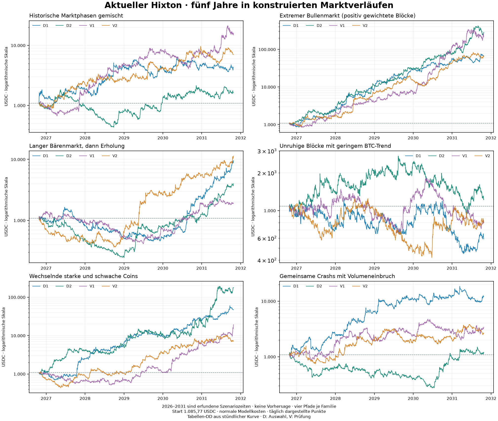

# Hixton: fünf Jahre in verschiedenen Marktbedingungen

Referenz: aktueller Bot `bd124cc5f7`, Start **1.085,77 USDC**, Gewinne wiederangelegt. Drei ausdrücklich getrennte Researchvarianten werden dagegen verglichen.
Die native Berechnung verwendet die aktuellen Kapital-, ATR-, Tranchenteilungs- und Diversifikationsregeln einschließlich der 32.000-USDC-Stufe; keine vereinfachte Ersatzstrategie.
Start ohne offene Modellpositionen mit festem Simulationskapital. Der Betrag ist ein Modellparameter; private Kontosnapshots sind nicht Bestandteil dieser Veröffentlichung.
156 vollständig geprüfte native Portfolioläufe: 104 Auswahl und 52 separate Modellprüfung.
Gemeinsames 15-Markt-Portfolio gemäß den aktuellen Entry-Freigaben: zehn Core-Märkte plus aktive Zwischenfüller AAVE/BCH/NEAR. SUI/UNI bleiben Research-only. Es gibt kein vervielfachtes Startkapital je Währung.

## Ergebnis des aktuellen Bots

Vier konstruierte Pfade je Familie. Spannweiten und Verlustfallzahlen beschreiben diese Pfade, keine Zukunftswahrscheinlichkeiten.

| Marktverlauf | End-USDC: kleinster–größter Wert | Median End-USDC | Schlimmster Schlusskurs-DD | Median bei höheren Kosten | Makroextreme Pfade |
|---|---:|---:|---:|---:|---:|
| Historische Marktphasen gemischt | 1.623,07–14.890,28 | 5.680,58 | 76,86 % | 3.152,55 | 2/4 |
| Extremer Bullenmarkt (positiv gewichtete Blöcke) | 64.077,52–285.831,63 | 140.292,02 | 51,54 % | 124.027,48 | 4/4 |
| Langer Bärenmarkt, dann Erholung | 1.885,33–11.339,36 | 6.771,48 | 79,66 % | 3.311,47 | 0/4 |
| Unruhige Blöcke mit geringem BTC-Trend | 591,64–1.232,83 | 808,76 | 68,39 % | 462,84 | 1/4 |
| Wechselnde starke und schwache Coins | 7.227,28–177.966,96 | 33.258,43 | 61,98 % | 18.703,86 | 3/4 |
| Gemeinsame Crashs mit Volumeneinbruch | 1.194,26–12.070,61 | 3.008,35 | 77,33 % | 1.745,54 | 0/4 |

Die Szenarionamen beschreiben die Auswahl historischer Blöcke; sie erzwingen keinen bestimmten Fünfjahres-Endkurs. Zur Einordnung der Modellpfade:

| Blockfamilie | BTC: Endkurs / Startkurs | ETH: Endkurs / Startkurs |
|---|---:|---:|
| Historische Marktphasen gemischt | 1,19–13,72× | 0,47–3,68× |
| Extremer Bullenmarkt (positiv gewichtete Blöcke) | 87,26–344,08× | 9,54–269,61× |
| Langer Bärenmarkt, dann Erholung | 0,53–1,57× | 0,05–0,66× |
| Unruhige Blöcke mit geringem BTC-Trend | 1,64–3,99× | 0,03–0,56× |
| Wechselnde starke und schwache Coins | 3,55–26,49× | 1,14–4,97× |
| Gemeinsame Crashs mit Volumeneinbruch | 0,57–5,25× | 0,12–3,65× |

In **24 von 24** konstruierten Normal-Kosten-Pfaden überschreitet der aktuelle Bot 30 % Schlusskurs-DD. Das ist keine Eintrittswahrscheinlichkeit; die aktive Strategie besitzt hier keine belastbar nachgewiesene 30-%-Verlustbegrenzung.
Auch unter den 14 Pfaden ohne Makro-Extremhinweis beträgt der schlimmste Schlusskurs-DD **79,66 %**. Diese rein beschreibende Untergruppe ändert weder die eingefrorene Auswahl noch die Prüfkriterien und stellt keine Zertifizierung realistischer Zukunftskurse dar.
Niedrigster modellierter Kontostand über diese Pfade: **240,10 USDC**, entsprechend **-77,89 %** gegenüber dem Startbudget. Diese Zahl ist vom Rückgang ab einem späteren Kontohöchststand zu unterscheiden.
Der Endwert allein zeigt weder den zwischenzeitlichen Verlust noch die Erholungsdauer. Bereits ein technisch korrekt abgewickelter Lauf kann wirtschaftlich untragbar sein.

## Vorab festgelegte Varianten

Auswahl nach höchstem mittleren Nettogewinn (Median), danach niedrigerem DD. Normales und erhöhtes Kostenmedian dürfen gegenüber dem aktuellen Bot nicht fallen.

| Variante | Median Netto-Gewinn | Median DD | Median Netto bei Stresskosten | Auswahlfähig |
|---|---:|---:|---:|---|
| Aktueller Bot | 5.852,41 | 57,75 % | 3.039,77 | ja |
| Ohne Zwischenfüller | 3.689,53 | 59,89 % | 2.165,95 | nein |
| 85 % Kapitalfreigabe | 4.645,83 | 55,63 % | 2.563,18 | nein |
| Core-Slots ohne doppelte Coinbelegung | 6.185,30 | 49,07 % | 3.165,27 | ja |

Vor Betrachtung der Prüfszenarien eingefroren: **Core-Slots ohne doppelte Coinbelegung**.
Gepaart auf denselben zwölf Auswahlpfaden: 5 besser, 7 schlechter, 0 gleich; Median des direkten Netto-Unterschieds **-180,18 USDC**. Die Differenz zweier unverbundener Mediane ist etwas anderes als der Median gepaarter Unterschiede; die ursprüngliche Auswahlregel wurde nicht nachträglich geändert.
Separate Modellprüfung: **NO_CHANGE**.
Gepaarter Median des Netto-Vorteils: normal **-955,66 USDC**, mit höheren Kosten **-71,69 USDC**.
Normale Prüffälle: 2 besser, 10 schlechter, 0 gleich.
Auch ein bestandener Modellvergleich erlaubt keine automatische Produkt- oder Liveänderung.

| Getrennte Prüffälle | Pfade | Median End-USDC aktuell | Median End-USDC Variante | Schlimmster DD aktuell | Schlimmster DD Variante |
|---|---:|---:|---:|---:|---:|
| Normale Kosten | 12 | 7.125,33 | 5.550,13 | 72,27 % | 75,77 % |
| Höhere Kosten | 12 | 3.993,20 | 3.286,21 | 83,26 % | 82,70 % |
| Stärkster Kostenstress, nur Crashfamilie | 2 | 1.407,26 | 1.254,15 | 62,91 % | 76,57 % |

Aktueller Bot im stärksten Crashkostenstress über alle vier Crashpfade: Endwerte **403,15–4.572,68 USDC**, schlimmster Schlusskurs-DD **90,15 %**.

## Was die Zahlen begrenzt

- Nominales USDC, kein Eurobetrag. Keine Prognose und keine Wahrscheinlichkeit, einen bestimmten Endbetrag zu erreichen.
- Endkapital bedeutet Cash plus zum letzten Kurs bewertete offene Bestände einschließlich Restmengen. Es wird am Studienende kein zusätzlicher Verkauf erzwungen; noch nicht angefallene Ausstiegskosten offener Bestände sind nicht als bereits bezahlt dargestellt.
- Gemeinsame historische 7-/14-/30-Tage-Blöcke erhalten Abhängigkeiten zwischen den 15 Coins. Neue Zufallszahlen liefern neue Kombinationen derselben bekannten Daten, keine wirklich ungesehene Marktgeschichte.
- Positiv gewichtete Blöcke können über fünf Jahre wirtschaftlich extreme Kursniveaus erzeugen. Die Spalte Makroextreme kennzeichnet BTC außerhalb 0,1–10× oder ETH außerhalb 0,05–20× des Startkurses. Das ist ein vorher festgelegter Kontextindikator, keine Wahrscheinlichkeitsgrenze. Solche Pfade bleiben vollständig erhalten, gelten als Sensitivitäts-/Extremtests und belegen keine realistische Gewinnperspektive.
- Die sechs Familien sind vorab gleich viele Vergleichsfälle, keine geschätzte Häufigkeitsmischung zukünftiger Marktregime. Ihr gemeinsamer Median dient ausschließlich diesem eingefrorenen Modellvergleich.
- Die gemeinsame Datenbasis enthält 2022 nicht. Heutige Coins, Filter und Überlebensauswahl bilden frühere Pleiten oder künftige Delistings nicht vollständig ab. Die externe BTC/ETH-Fünfjahreskalibrierung zeigt deutlich stärkere historische Bärenmärkte.
- Kein Orderbuch, keine Marktbeeinflussung, keine echten Teilausführungen. Teilnahme am vorherigen Stundenvolumen ist ein Warnindikator, kein Ausführbarkeitsbeweis.
- In den 24 normalen Baselinepfaden liegen 854 von 14824 modellierten Orders über 5 % des vorherigen Stundenvolumens. Größtes Verhältnis: 4.255,86 %.
- Kosten pro Kauf und Verkauf: normal 10 bp Gebühr + 2 bp Spread + 3 bp Slippage; Stress 10 + 10 + 20 bp. Im Crash zusätzlich 10 + 15 + 25 bp. Kein angenommener BNB-Rabatt.
- Crashfamilie: zusätzliche BTC-Sprünge von −35 % und −20 %, für andere Coins über historische Betas von 0,5–2 skaliert, sowie jeweils 80 % weniger Quotevolumen für 72 Stunden. Absichtlich widrige Stressbedingungen, keine Behauptung ihrer Eintrittshäufigkeit.
- Der native DD misst stündliche Schlussmarkierungen. Die Grafik zeigt täglich ausgedünnte Punkte, die Tabellen verwenden die vollständigen Stundenkurven. Intrastündliche Verluste können größer sein. Zusätzliche OHLC-Stressmarkierungen sind konstruierte Hüllen, keine beobachteten Intrastundenkurven oder garantierten Verlustgrenzen.
- Keine Strom-, Internet-, Börsen-, Gegenpartei- oder USDC-Entkopplungsausfälle modelliert. Ein lokal ausgeschalteter Bot kann keine Strategieausstiege ausführen.

## Nachprüfbarkeit

`Context.json`, `Study-Approval.json` und `Model-Contract.json` wurden vor den neuen Ergebnissen eingefroren. Auswahl und Prüffälle sind getrennt; jeder Lauf speichert Fills, Signale, Equity und Prüfsummen. Kein schlechter Pfad wurde ersetzt.
`Discovery-Selection.json` bindet alle Auswahlresultate; `Validation-Summary.json` bindet die späteren Prüffälle. `Alle-Ergebnisse.csv` enthält sämtliche Resultate.
`Coin-Beitraege.csv` zeigt die 15 Coinbeiträge je normalem Baselinepfad im gemeinsamen Portfolio. Der PnL dort bezieht sich auf geschlossene Exitanteile; noch offene Positionen und Restbestände sind darin nicht als vollständig realisierter Gewinn enthalten. Es sind keine 15 separaten Konten mit jeweils dem gesamten Startkapital.
Die native Buchhaltung wurde stündlich exakt nachgerechnet; keine negativen Cash-/Bestandswerte, keine Ausführung vor einem abgeschlossenen Signal, DD unabhängig nachgerechnet. Die Zukunftsänderungsprobe bewahrte die früheren Signale und Fills.
`Marktpfade.png` zeigt den vorab festgelegten ersten Auswahlpfad jeder Familie für alle 15 Märkte; BTC/ETH sind hervorgehoben. Keine Auswahl eines besonders erfolgreichen Beispiels.
Methodischer Bezug: [Politis & Romano (1994)](https://doi.org/10.1080/01621459.1994.10476870). Diese bedingte Blocksimulation beansprucht keine Zukunfts-Konfidenzintervalle.

## Entscheidung und nächste Forschung

**NO_CHANGE: Keine der untersuchten Änderungen wird in den laufenden Bot übernommen.** Die ausgewählte Variante verfehlt alle drei vorab festgelegten Prüfbedingungen. Es wird keine andere Variante nachträglich als Gewinner ausgewählt.

Die Studie belegt keine robuste 30-%-Verlustbegrenzung und keinen erwartbaren Fünfjahresgewinn. Makroextreme, bekannte wiederverwendete Daten und fehlende Orderbuch-/Markteinflussdaten begrenzen die Aussagekraft.

Sinnvolle nächste Untersuchungen sind ein kausales Kapazitäts-/Slippagemodell, eine separat vorab festgelegte Prüfung gegen wiederholte Fehleinstiege in unruhigen Marktphasen und unveränderte Regeln auf tatsächlich neuen Marktdaten. Das sind offene Forschungsaufgaben, keine bereits bewiesenen Gewinnverbesserungen. Ein gewünschter Verlustdeckel erfordert eine eigene überprüfte Risikoregel samt offengelegtem Renditeverzicht.

Die Veröffentlichung enthält synthetische Ergebnisdaten und Methodenquellen. Originale Signal-/Fill-/Equitydateien und große Marktdaten bleiben lokal; ihre Digests stehen in den unveränderten Auswahl-/Prüfmanifesten. `Simulation-Spezifikation.json` ist ausdrücklich eine öffentliche Ableitung des privaten Kontextdokuments und ersetzt dessen Originalhash nicht.
